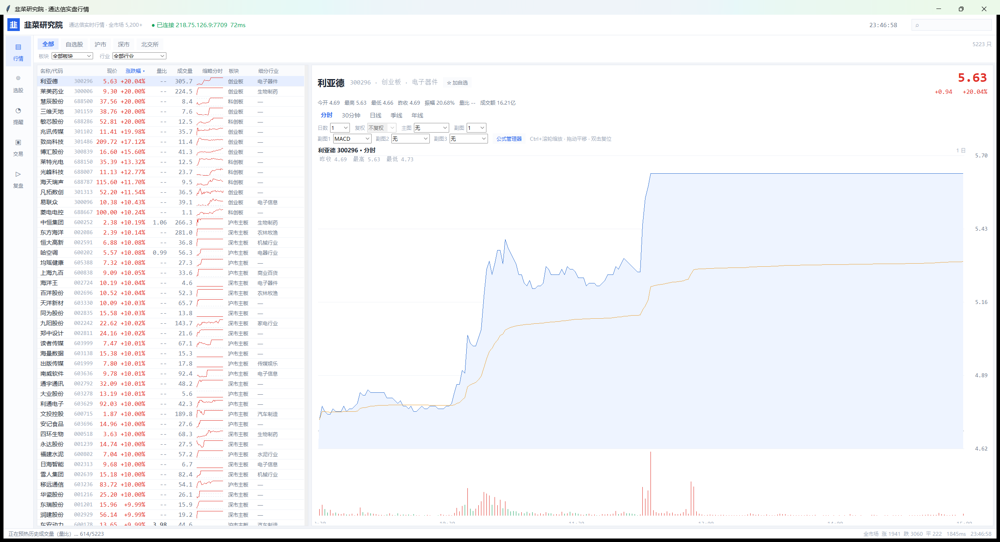

# 韭菜研究院 · A股行情终端

一个用 Python + Tkinter 写的 Windows 桌面行情软件，直连**通达信行情服务器**（TCP 7709），
覆盖全市场 5,200+ 只 A 股，支持全历史 K 线、1~10 日分时、前/后复权，以及**通达信指标公式**的导入与绘制。



> 纯 Python 实现，无 Electron、无 WebView、无 numpy 依赖；打包后是 33 MB 单文件 exe，双击即用。

---

## 功能

| 模块 | 能力 |
|---|---|
| 行情 | 全市场列表（名称/代码、现价、涨跌幅、量比、成交量、缩略分时、板块、细分行业） |
| 筛选 | 全部 / 自选股 / 沪市 / 深市 / 北交所，叠加板块与细分行业下拉 |
| 详情 | 分时（1~10 日）、30 分钟、日线、季线、年线；全部为上市以来完整历史 |
| 交互 | Ctrl+滚轮缩放、滚轮/拖动平移、双击复位、十字光标、副图读数跟随鼠标 |
| 复权 | 不复权 / 前复权 / 后复权（基于通达信 XDXR 除权除息数据计算） |
| 指标 | 主图叠加或 0~3 个副图，支持上传通达信公式，内置公式管理器 |
| 自选 | 自定义分组、按组过滤、右键加入分组 |
| 选股 | 多条件实时筛选，结果可跳转到行情 |
| 提醒 | 价格上穿/下穿、涨幅突破、量比突破，触发即弹窗 |
| 交易 | 模拟盘下单（不连接真实柜台） |

### 列表右键

添加至自选股（含分组）、展示该板块内股票、展示该行业内股票、多股同列（2×2）、复制代码。

### 搜索

代码、名称、**拼音首字母**（`GZMT` → 贵州茅台）三合一，实时过滤，回车直达详情。

---

## 快速开始

### 方式一：直接用 exe（推荐给使用者）

到右侧 **[Releases](../../releases)** 下载 `韭菜研究院-v1.1-win64.zip`，解压后双击 `韭菜研究院.exe`。

Windows 10/11 64 位，无需安装 Python，无需任何运行库。首次运行若提示「Windows 已保护你的电脑」，
点「更多信息 → 仍要运行」（PyInstaller 单文件常见误报）。

> 用 `git clone` 下载的话，仓库根目录里也带着同一个 exe；网页版仓库为控制体积只放了源码，
> 程序放在 Releases，点两下就能拿到。

### 方式二：从源码运行（推荐给开发者）

```bash
git clone https://github.com/<your-name>/jiucai-yanjiuyuan.git
cd jiucai-yanjiuyuan
pip install -r requirements.txt
python app.py
```

要求 Python 3.10+，且**必须带 tkinter**（Windows 官方安装包默认包含；Linux 需 `apt install python3-tk`；
macOS 用 python.org 版本）。托管式/精简版 Python 常常没有 tkinter，会直接报 `ModuleNotFoundError`。

---

## 技术要点

### 1. 通达信协议：跳过第三个握手包

`pytdx` 连接时会发三个握手包，第三个是旧版客户端身份包。新版行情服务器收到后会**切换响应编码**，
表现为：`get_security_bars` 返回 `None`、`get_security_quotes` 返回 `[]`、分时数据解析成乱码（价格为负）。

处理方式是在导入前禁用它：

```python
import pytdx.parser.setup_commands as setup
setup.SetupCmd3.call_api = lambda self: None
```

之后 7709 端口的日线、五档、历史分时全部正常。这是本项目最关键的一处兼容处理。

### 2. 双连接 + 分片轮询

全市场 5,200 只、每批 80 只，一轮 66 次请求。用一条连接专供快照轮询，另一条供 K 线/分时，
避免点开详情时排在 60 多个快照请求后面。

### 3. 指标公式引擎

不依赖 numpy，自己写了**词法分析 + 递归下降语法树 + 列表序列求值**：

- 支持 `MA EMA SMA DMA WMA REF HHV LLV SUM STD COUNT EVERY EXIST BARSLAST IF CROSS BETWEEN ...`
- 支持中文变量名（`量比:VOL/MA(VOL,5);`）
- `COLORSTICK` 渲染成柱状（MACD 可用），`STICKLINE` 等纯绘图语句自动跳过
- 语法错误会定位到具体记号并弹出提示

### 4. 复权计算

从 `get_xdxr_info` 取除权除息记录，按

```
r = (前收 − 每股现金 + 配股价 × 配股比例) / (前收 × (1 + 送转配比例))
```

逐条算出除权比例，再按事件时间对每根 K 线累积因子：前复权乘事件之后的因子，后复权除事件之前的因子。

### 5. 全历史 K 线

单次请求上限 800 根，按 800 翻页直到取空（单只上限 24,000 根）。30 分钟约 8 页、日线约 6 页，
拉完缓存在内存，切换周期不重复请求。

---

## 目录结构

```
jiucai-yanjiuyuan/
├── app.py                 入口
├── core/
│   ├── tdx.py             通达信接入：连接池、快照、K线翻页、分时
│   ├── formula.py         指标公式引擎（纯 Python）
│   ├── adjust.py          复权计算
│   ├── catalog.py         板块/行业/拼音首字母
│   ├── store.py           配置、自选分组、公式存储
│   ├── bj_seed.json       北交所代码表快照
│   └── industry.json      行业分类映射
├── ui/
│   ├── window.py          主窗口：左导航、数据中枢、搜索
│   ├── page_market.py     行情页 + 公式管理器 + 多股同列
│   ├── page_other.py      选股 / 提醒 / 交易 / 复盘
│   ├── chart.py           图表：多副图、缩放、十字光标
│   ├── table.py           自绘虚拟滚动列表
│   └── theme.py           配色与字体
├── formulas/              可直接导入的示例公式
├── docs/
│   ├── user-guide.md      详细使用说明
│   └── BUILD.md           打包说明
└── screenshots/
```

用户数据（自选分组、上传的公式、成交量缓存）写在 `%APPDATA%\JiuYanTerminal\`。

---

## 已知限制

1. **Level-1 行情**：3 秒快照，全市场一轮约 1.5–2.5 秒，列表实际 3 秒刷新；没有逐笔委托队列。
2. **行业覆盖约 3,000 / 5,223 只**：分类来自公开的行业分类接口，未收录的显示「—」。
3. **北交所**：标准行情接口不返回其代码表，用内置 920 号段快照引导，新股可能缺失。
4. **不复权为默认**，与行情软件盘面一致；看长周期建议切到前复权。
5. 交易页是**模拟盘**，不连接任何券商柜台。
6. 不提供财务数据、公告、龙虎榜。

---

## 免责声明

- 本项目的行情接入基于**逆向分析**的公开协议实现，仅用于**学习与技术研究**，请勿用于商业分发。
- 行情数据版权归交易所及各数据提供方所有；本项目不存储、不再分发历史行情数据。
- 本项目**不构成任何投资建议**。据此操作，风险自负。
- 复盘页中的观点卡片为**演示数据**，不代表任何真实投资观点。

---

## License

[MIT](LICENSE)
